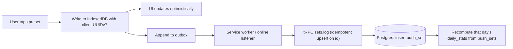
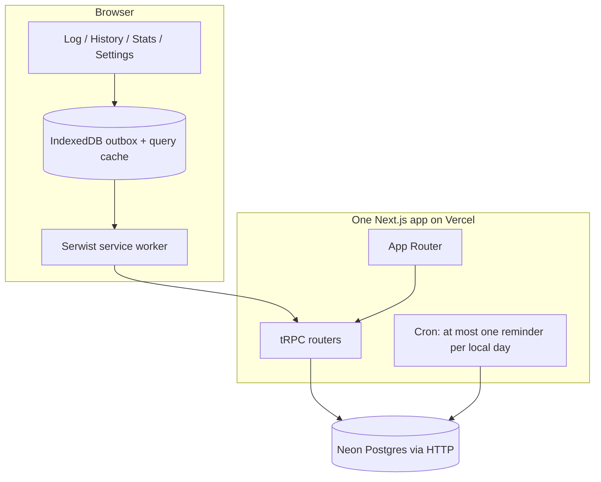

# Drop and Give Me 50

A beautiful, installable web app for tracking one exercise: push-ups. Not a
generic fitness tracker — see [docs/prd.md](./docs/prd.md) for why that's a
deliberate choice, not a limitation.

- [docs/prd.md](./docs/prd.md) — product vision, philosophy, scope, health
  philosophy, rejected features
- [docs/architecture.md](./docs/architecture.md) — stack, schema, API
  boundaries, folder structure, roadmap, risks
- [docs/decisions.md](./decisions.md) — decisions locked for the duration
  of the build, with rationale
- [docs/case-study.md](./docs/case-study.md) — portfolio write-up, led by
  what was cut

## Status

**Phase 6 — Portfolio pass.** README, a year of seeded demo data, a
Lighthouse check against the production PWA shell, the Playwright
offline-sync path, and the case study. No Version 2 feature is built
until this user has logged on 30 separate days — see
[docs/architecture.md §8](./docs/architecture.md#8-development-phases).

## Architecture

Writes hit IndexedDB first. The network is an afterthought. Rewards are
never stored as their own source of truth.





Full schema, API list, and the decisions behind this shape:
[docs/architecture.md](./docs/architecture.md).

## Stack

Next.js (App Router) + TypeScript + React, tRPC, Drizzle ORM on Postgres
(Neon), Auth.js, deployed on Vercel. Full rationale in
[docs/architecture.md](./docs/architecture.md).

## Getting started

```bash
npm install
cp .env.example .env.local   # then fill in the values below
npm run db:migrate            # apply the schema to your database
npm run db:seed               # seed the 22 push-up variations
npm run dev
```

Open [http://localhost:3000](http://localhost:3000).

### Required environment variables

- `DATABASE_URL` — a Neon Postgres connection string.
- `AUTH_SECRET` — session/cookie signing secret. Generate with
  `npx auth secret`, or any long random string. Use a different value per
  environment (local vs. Vercel).
- `AUTH_GOOGLE_ID` / `AUTH_GOOGLE_SECRET` — a Google OAuth 2.0 client:
  1. Go to the [Google Cloud Console credentials
     page](https://console.cloud.google.com/apis/credentials), create a
     project if you don't have one.
  2. Configure the OAuth consent screen (External, or Internal if using a
     Google Workspace account) — for personal use, add yourself as a test
     user.
  3. Create an OAuth client ID of type **Web application**.
  4. Add an authorized redirect URI for every environment you use it in,
     exactly: `<origin>/api/auth/callback/google` — e.g.
     `http://localhost:3000/api/auth/callback/google` for local dev, and
     `https://<your-vercel-domain>/api/auth/callback/google` for
     production.
  5. Copy the generated **Client ID** and **Client secret** into
     `AUTH_GOOGLE_ID` and `AUTH_GOOGLE_SECRET` locally, and into the
     Vercel project's environment variables for production (with the
     production redirect URI added in step 4).

- `VAPID_PUBLIC_KEY` / `VAPID_PRIVATE_KEY` / `VAPID_SUBJECT` — Web Push.
  Generate with `npx web-push generate-vapid-keys`. `VAPID_SUBJECT` is a
  `mailto:` or `https:` URL. Required for reminders; the rest of the app
  runs without them.
- `CRON_SECRET` — bearer token for `GET /api/cron/reminders`. Set the same
  value in Vercel; Cron Jobs send `Authorization: Bearer $CRON_SECRET`.
  `vercel.json` schedules that route every 15 minutes.

Optional seed ids (the Auth.js `user.id` uuid from Neon):

- `DEMO_SEED_USER_ID` — `npm run db:seed:demo` writes a year of synthetic
  sets (`source: "backfill"`, `note: "demo-year"`) so History and Stats
  are presentable. Skips if that note is already on the user. Today is
  left empty so a live log still has somewhere to go.
- `RAMP_SEED_USER_ID` — `npm run db:seed:ramp` writes the 28-day binge
  fixture so the ramp card fires.

## Scripts

| Script | Purpose |
| --- | --- |
| `npm run dev` | Start the Next.js dev server |
| `npm run build` | Production build |
| `npm run start` | Run the production build |
| `npm run lint` | ESLint |
| `npm run typecheck` | Generate route types, then `tsc --noEmit` |
| `npm run test` | Run the unit test suite (Vitest) |
| `npm run test:e2e` | Playwright: install SW, go offline, log three sets, reconnect, verify Postgres |
| `npm run lighthouse` | Lighthouse + PWA installability check against `next start` on port 4173 |
| `npm run db:generate` | Generate a SQL migration from `src/server/db/schema.ts` |
| `npm run db:migrate` | Apply generated migrations to `DATABASE_URL` |
| `npm run db:push` | Push the schema directly (fast local iteration only) |
| `npm run db:studio` | Open Drizzle Studio against `DATABASE_URL` |
| `npm run db:seed` | Seed/update the 22 push-up variations |
| `npm run db:seed:ramp` | Optional: seed a 28-day binge fixture (`RAMP_SEED_USER_ID`) |
| `npm run db:seed:demo` | Optional: seed a year of training (`DEMO_SEED_USER_ID`) |

`test:e2e` and `lighthouse` need a production build first (`npm run build`)
and, for e2e, a real `DATABASE_URL` with variations seeded. E2E uses the
machine's installed Chrome (`channel: "chrome"`).

## CI

`.github/workflows/ci.yml` runs typecheck, lint, unit tests, a production
build, and a migration-drift check (fails if the schema changed without a
committed, generated migration) on every push to `main` and every pull
request.

Playwright and Lighthouse stay off that job: CI has a placeholder
`DATABASE_URL` and no Chrome. Adding Postgres plus a browser would be a
different CI architecture than the one in
[docs/architecture.md §1](./docs/architecture.md#1-stack-overview).
