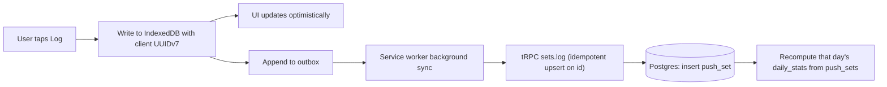
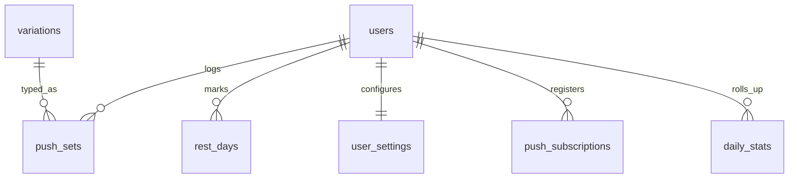

# Drop and Give Me 50 — Technical Architecture

This is the engineering counterpart to [prd.md](./prd.md). The choices in
[decisions.md](./decisions.md) stay in force.

## 1. Stack overview

Single Next.js application. No monorepo, no second service.

- **Frontend:** Next.js App Router, React, TypeScript. The logging surface
  is a client component; the rest of the app shell is server-rendered
  where possible. Motion for animation, `navigator.vibrate` for
  haptics (supported on Android, the target platform).
- **Data layer:** TanStack Query with an IndexedDB-backed persister
  (Dexie), plus an explicit outbox table. Writes hit IndexedDB
  and the UI first; the network call is an afterthought, not a blocker.
- **API:** tRPC, a single router tree. End-to-end types, no codegen, no
  schema drift between client and server.
- **Backend:** Next.js route handlers on Vercel, Node runtime for anything
  touching Postgres or web push.
- **Database:** Postgres on [Neon](https://neon.tech). Drizzle ORM +
  Drizzle Kit migrations, chosen over Prisma for serverless cold-start and
  SQL transparency. The app connects via `@neondatabase/serverless`'s HTTP
  driver (`drizzle-orm/neon-http`) rather than a pooled TCP client: Vercel
  route handlers are short-lived, and repeatedly opening TCP connections
  from serverless functions is what exhausts Postgres connection limits.
  The HTTP driver issues one fetch per query with nothing to pool.
- **Auth:** Auth.js v5, Google provider only, database session strategy,
  Drizzle adapter.
- **Notifications:** Web Push with VAPID, service worker via Serwist.
  Vercel runs the reminder route once an hour (24 daily cron jobs, because
  Hobby rejects a `*/15` schedule). A run sends at most one reminder per
  user per local day, and only when that user's reminder time has arrived.
- **Domain analytics:** `daily_stats`. There is no separate product-analytics
  vendor.
- **Testing:** Vitest for pure-function domain logic (streaks, load,
  timezone math) — these must be pure functions specifically so they're
  cheaply testable. Playwright for one end-to-end path: install, go
  offline, log three sets, reconnect, verify sync.
- **CI:** GitHub Actions running typecheck, lint, unit tests, build, and a
  migration-drift check, on every push to `main` and every pull request.
  See `.github/workflows/ci.yml`.

### Why a PWA and not a native app

The user's daily device is Android, where Chrome supports installable
PWAs, web push, background sync, haptics, and manifest shortcuts — which
together cover nearly everything a native app would offer here. The one
real gap is a true home-screen widget, which no PWA can provide. Per
[decisions.md](./decisions.md#14), that is the only condition that reopens
the native-app question; nothing else (push reliability, install friction,
app-store presence) is sufficient justification on its own.

## 2. Offline write flow



Sync policy: the server is authoritative, last-write-wins on `updated_at`,
and the client retries the outbox indefinitely using the same client-
generated UUID. No CRDTs — for a single user across at most a couple of
devices, LWW is correct and anything more complex is unjustified
engineering.

**Not a real transaction, and that's fine.** `drizzle-orm/neon-http` has no
persistent connection to hold a transaction open — `db.transaction()`
throws unconditionally by design. So the insert and the `daily_stats`
recompute are two sequential statements in the same request, not one
atomic transaction. This is safe specifically because `daily_stats` is a
derived cache, never a source of truth (see
[decisions.md #8](./decisions.md#8)): if the process dies between the two
steps, the set is already durable and `daily_stats` is merely stale for
that day until the next write to it recomputes the row from scratch.
Switching to `drizzle-orm/neon-serverless` (a WebSocket pool) would restore
real transactions, but at the cost of reintroducing the connection-pooling
concern this driver choice was made to avoid — not worth it for a value
that's designed to self-heal.

## 3. Database schema

Auth.js tables (`users`, `accounts`, `sessions`, `verification_tokens`) are
standard and omitted here.

**`variations`** — seeded static reference data, 22 rows.
- `id` text PK (slug, e.g. `diamond`)
- `name` text, `sort_order` int, `is_active` bool
- `family` text — one of `scapular`, `assisted`, `standard`, `tricep`,
  `wide`, `dynamic`, `shoulder`, `unilateral`, `advanced`
- `intensity_factor` numeric(3,2) — load relative to a regular push-up.
  Knee ≈0.55, regular 1.00, diamond ≈1.15, archer ≈1.5, handstand ≈2.2.
  Shown to the user, never hidden.
- `difficulty` smallint 1–5 — display and sort only
- `primary_emphasis` text — `chest`, `triceps`, `shoulders`, `serratus`,
  `core`

Deliberately absent: icons, video links, progression edges (see
[decisions.md](./decisions.md#10)).

**`push_sets`** — the atomic unit. There is no parent workout entity;
same-day sets are grouped for display only.
- `id` uuid PK, generated on the **client** as UUIDv7 — this is the
  idempotency key that makes offline retry safe
- `user_id` uuid FK, `variation_id` text FK
- `reps` int, checked between 1 and 500
- `occurred_at` timestamptz
- `local_date` date — computed at write time from the user's timezone and
  day-start offset, never derived from UTC at read time
- `tz` text — the IANA zone captured at write
- `note` text nullable — unused by the app. Seed scripts write a private
  tag here (`demo-year`, `ramp-fixture`) so a second run can recognize its
  own rows. Logging, history, and edit do not read or write it.
- `source` text — `app`, `shortcut`, `backfill`
- `created_at`, `updated_at`, `deleted_at` (soft delete; lists omit
  tombstoned rows)
- Indexes: `(user_id, local_date)`, `(user_id, occurred_at desc)`,
  `(user_id, updated_at)`

**`rest_days`** — PK `(user_id, local_date)`, plus `note`, `created_at`.
`note` is the same kind of seed tag as on `push_sets`; the app does not
read or write it. A rest day satisfies the weekly target.

**`daily_stats`** — derived rollup, rewritten in the same request as the
set write (two sequential statements, not one transaction — see §2).
PK `(user_id, local_date)`.
- `total_reps` int, `set_count` int, `volume_load` numeric (sum of
  `reps * intensity_factor`), `first_at`, `last_at`, `top_variation_id`,
  `is_rest_day` bool
- Exists so the heatmap and load calculations read one row per day instead
  of aggregating raw sets on every request.

**`user_settings`** — PK `user_id`. `weekly_target_days` (default 5),
`daily_rep_goal` (default 50), `reminder_time`, `reminder_enabled`, `tz`,
`day_start_offset_minutes` (default 0), `haptics_enabled`,
`disclaimer_accepted_at`, `onboarded_at`.

**`push_subscriptions`** — `id`, `user_id`, `endpoint` (unique), `p256dh`,
`auth`, `user_agent`, `last_success_at`, `failure_count`.

**Not tables.** Streaks, personal records, and milestones are computed
from `push_sets` and `daily_stats`, never stored as their own source of
truth (see [decisions.md](./decisions.md#8)). The week streak is a pure
function over those day rows (`src/domain/streak.ts`).



## 4. API boundaries

One tRPC router tree. Set writes are idempotent on a client-supplied ID.

- `sets.log` — upsert on `id`, then recomputes `daily_stats` as the next
  statement in the same request
- `sets.update`, `sets.delete` (soft), `sets.list` (cursor-paginated)
- `days.today` — totals, weekday week state, goal state
- `days.range` — `daily_stats` rows for the heatmap, bounded to a date
  window
- `rest.mark`, `rest.unmark`
- `stats.overview` — lifetime totals, PRs, current/longest week-streak,
  variation breakdown
- `stats.load` — rolling 7-day load, 28-day baseline, ratio, and which
  educational card (if any) is triggered
- `variations.list`
- `settings.get`, `settings.update`, `settings.completeOnboarding`
- `push.subscribe`, `push.unsubscribe`, `push.sendTest`, `push.publicKey`

## 5. Folder structure

```
src/
  app/            routes only (App Router: (onboarding) and (app) groups,
                  plus /offline)
  features/       logging, history, stats, settings, onboarding, shell
  server/         tRPC routers, db schema (server/db), services
  lib/            offline outbox, push, env — cross-feature utilities
  domain/         pure functions (streaks, load, records, dates) — the
                  direct unit-test target, kept free of framework/IO
docs/             this document, the product vision, the decisions record,
                  and the case study
drizzle/          generated SQL migrations + snapshot metadata (committed)
e2e/              Playwright airplane-mode spec (not on GitHub Actions)
scripts/          variation / demo / ramp seeds, Lighthouse runner
```

Feature folders over type folders so a change to one screen stays in one
directory.

**What the app is.** Schema, Google auth, and the tRPC routers above. The
Log screen: counter, last-used variation, Log button, 7-day weekday dots,
rest-day toggle. No preset chips and no set notes. History: heatmap,
grouped edit/delete, week streak. Stats: lifetime, PRs, consistency rate,
load, educational cards. Settings. Two onboarding cards, then the health
disclaimer. IndexedDB outbox and TanStack Query persistence. A Serwist
service worker with an `/offline` fallback and Web Push display. A web
app manifest with Log 20 / Log 50 shortcuts. At most one reminder per
local day, from 24 hourly Vercel cron jobs. In-app PR/milestone toasts.
A year-of-training seed (`npm run db:seed:demo`). The Playwright
offline-sync spec (`npm run test:e2e`) logs three sets by tapping Log 20.
The Lighthouse + installability check (`npm run lighthouse`). The case
study lives in [docs/case-study.md](./case-study.md).

## 6. Environment and configuration

- `DATABASE_URL` — Neon Postgres connection string. Read via
  `src/lib/env.ts`, which throws a clear error only when a code path
  actually accesses it (lazy getter), so builds and routes that don't
  touch the database still work without it configured.
- `drizzle.config.ts` loads `.env.local` then `.env` itself via `dotenv`,
  since `drizzle-kit` runs as a standalone CLI outside Next.js and doesn't
  get Next's automatic env loading.
- Auth.js `trustHost: true` (`src/server/auth/index.ts`) — required so
  `next start` (Playwright, Lighthouse, local production) can read
  sessions. Vercel already infers a trusted host; production Node without
  it raises `UntrustedHost` and every request looks signed-out. This is
  not a new provider or session strategy.
- See `.env.example` for the current full list (`VAPID_*` and `CRON_SECRET`
  are required for push; `DEMO_SEED_USER_ID` / `RAMP_SEED_USER_ID` are
  optional seed-script ids; the rest of the app still runs without them).

## 7. CI and the migration-drift check

`.github/workflows/ci.yml` runs, in order: typecheck (`next typegen` then
`tsc --noEmit`), lint, unit tests, build, then `npm run db:generate`
followed by `git diff --exit-code -- drizzle`. If a schema change wasn't
accompanied by a committed, generated migration, this fails the build. CI
uses a placeholder `DATABASE_URL` — `drizzle-kit generate` only diffs the
schema file against the local `drizzle/meta` snapshot, it never connects to
a database, but `drizzle.config.ts` still requires the variable to be
present to construct its config object.

`npm run db:push` remains available for fast local iteration against a
scratch Neon branch during development; `db:generate` + `db:migrate` is
the path actually used to apply changes to any shared/production database.

Playwright (`npm run test:e2e`) and Lighthouse (`npm run lighthouse`) are
intentionally not on this job. CI's `DATABASE_URL` is a placeholder that
never connects, and the runner has no Chrome. The airplane-mode spec
needs a real Neon database, a production service worker from `next start`,
and a signed-in session cookie. Putting those on GitHub Actions would be
a new CI architecture — Postgres, browser install, secrets — which §1
does not include. Run them locally (or on demand) against the same Neon
the app already uses.

## 8. Risks

- **Offline sync correctness** is the top engineering risk. Mitigated by
  idempotent client-generated keys, single-table writes, LWW, and one
  end-to-end airplane-mode test.
- **Timezones** are the top silent-bug risk. Mitigated by storing
  `local_date` at write time and testing DST explicitly.
- **Logging friction** is the top product risk — if logging takes longer
  than doing five push-ups, the app dies. Mitigated by remembering the
  last variation and the last rep count, the home-screen shortcuts, and
  treating time-to-log as a guardrail.
- **Health messaging** is the top liability risk. Mitigated by the
  disclaimer, the absence of personalized medical claims, visible
  thresholds, and honest labelling of contested heuristics (e.g. the ramp
  card's acute:chronic load ratio is a rough, visible heuristic, not a
  medical judgment).
- **Scope.** The product is the vision in [prd.md](./prd.md). Features
  that document refuses stay out.
- **Scalability is a non-issue at this user count.** The genuinely
  interesting engineering problems here are read-path rollups and offline
  convergence, not write throughput.
