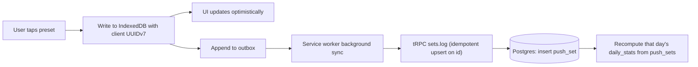
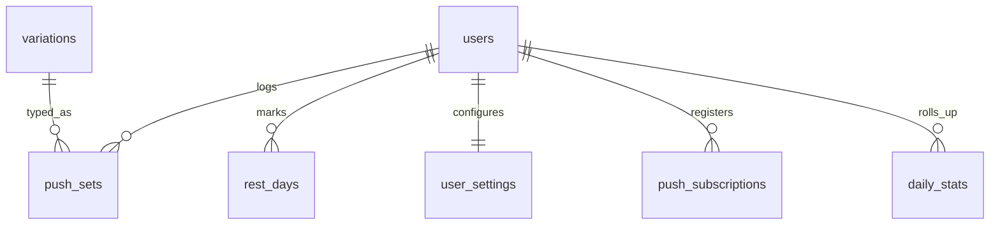

# Drop and Give Me 50 — Technical Architecture

This is the engineering counterpart to [prd.md](./prd.md). Anything listed
in [decisions.md](./decisions.md) is locked; do not redesign it mid-phase.

## 1. Stack overview

Single Next.js application. No monorepo, no second service.

- **Frontend:** Next.js App Router, React, TypeScript. The logging surface
  is a client component; the rest of the app shell is server-rendered
  where possible. Motion for animation (Phase 2+), `navigator.vibrate` for
  haptics (supported on Android, the target platform).
- **Data layer:** TanStack Query with an IndexedDB-backed persister
  (Dexie), plus an explicit outbox table (Phase 2). Writes hit IndexedDB
  and the UI first; the network call is an afterthought, not a blocker.
- **API:** tRPC, a single router tree. End-to-end types, no codegen, no
  schema drift between client and server.
- **Backend:** Next.js route handlers on Vercel, Node runtime for anything
  touching Postgres or web push.
- **Database:** Postgres on [Neon](https://neon.tech). Drizzle ORM +
  Drizzle Kit migrations, chosen over Prisma for serverless cold-start and
  SQL transparency. The app connects via `@neondatabase/serverless`'s HTTP
  driver (`drizzle-orm/neon-http`) rather than a pooled TCP client: Vercel
  route handlers are short-lived, and repeatedly opening TCP connections
  from serverless functions is what exhausts Postgres connection limits.
  The HTTP driver issues one fetch per query with nothing to pool.
- **Auth:** Auth.js v5, Google provider only, database session strategy,
  Drizzle adapter (Phase 1).
- **Notifications:** Web Push with VAPID, service worker via Serwist,
  triggered by a Vercel Cron job every 15 minutes that fires for users
  whose local reminder time has arrived (Phase 5).
- **Analytics:** PostHog (free tier) for product events; `daily_stats` for
  domain analytics. The two are not conflated.
- **Testing:** Vitest for pure-function domain logic (streaks, load,
  timezone math) — these must be pure functions specifically so they're
  cheaply testable. Playwright for one end-to-end path: install, go
  offline, log three sets, reconnect, verify sync (Phase 2).
- **CI:** GitHub Actions running typecheck, lint, unit tests, build, and a
  migration-drift check, on every push to `main` and every pull request.
  See `.github/workflows/ci.yml`.

### Why a PWA and not a native app

The user's daily device is Android, where Chrome supports installable
PWAs, web push, background sync, haptics, and manifest shortcuts — which
together cover nearly everything a native app would offer here. The one
real gap is a true home-screen widget, which no PWA can provide. Per
[decisions.md](./decisions.md#14), that is the only condition that reopens
the native-app question; nothing else (push reliability, install friction,
app-store presence) is sufficient justification on its own.

## 2. Offline write flow (target shape, built in Phase 2)



Sync policy: the server is authoritative, last-write-wins on `updated_at`,
and the client retries the outbox indefinitely using the same client-
generated UUID. No CRDTs — for a single user across at most a couple of
devices, LWW is correct and anything more complex is unjustified
engineering.

**Not a real transaction, and that's fine.** `drizzle-orm/neon-http` has no
persistent connection to hold a transaction open — `db.transaction()`
throws unconditionally by design. So the insert and the `daily_stats`
recompute are two sequential statements in the same request, not one
atomic transaction. This is safe specifically because `daily_stats` is a
derived cache, never a source of truth (see
[decisions.md #8](./decisions.md#8)): if the process dies between the two
steps, the set is already durable and `daily_stats` is merely stale for
that day until the next write to it recomputes the row from scratch.
Switching to `drizzle-orm/neon-serverless` (a WebSocket pool) would restore
real transactions, but at the cost of reintroducing the connection-pooling
concern this driver choice was made to avoid — not worth it for a value
that's designed to self-heal.

## 3. Database schema (designed now, implemented in Phase 1)

Auth.js tables (`users`, `accounts`, `sessions`, `verification_tokens`) are
standard and omitted here.

**`variations`** — seeded static reference data, 22 rows.
- `id` text PK (slug, e.g. `diamond`)
- `name` text, `sort_order` int, `is_active` bool
- `family` text — one of `scapular`, `assisted`, `standard`, `tricep`,
  `wide`, `dynamic`, `shoulder`, `unilateral`, `advanced`
- `intensity_factor` numeric(3,2) — load relative to a regular push-up.
  Knee ≈0.55, regular 1.00, diamond ≈1.15, archer ≈1.5, handstand ≈2.2.
  Shown to the user, never hidden.
- `difficulty` smallint 1–5 — display and sort only
- `primary_emphasis` text — `chest`, `triceps`, `shoulders`, `serratus`,
  `core`

Deliberately absent: icons, video links, progression edges (see
[decisions.md](./decisions.md#10)).

**`push_sets`** — the atomic unit. There is no parent workout entity;
same-day sets are grouped for display only.
- `id` uuid PK, generated on the **client** as UUIDv7 — this is the
  idempotency key that makes offline retry safe
- `user_id` uuid FK, `variation_id` text FK
- `reps` int, checked between 1 and 500
- `occurred_at` timestamptz
- `local_date` date — computed at write time from the user's timezone and
  day-start offset, never derived from UTC at read time
- `tz` text — the IANA zone captured at write
- `note` text nullable
- `source` text — `app`, `shortcut`, `backfill`
- `created_at`, `updated_at`, `deleted_at` (soft delete, so sync can
  propagate tombstones)
- Indexes: `(user_id, local_date)`, `(user_id, occurred_at desc)`,
  `(user_id, updated_at)` for sync pull

**`rest_days`** — PK `(user_id, local_date)`, plus `note`, `created_at`. A
rest day satisfies the weekly target.

**`daily_stats`** — derived rollup, upserted in the same transaction as
the set write. PK `(user_id, local_date)`.
- `total_reps` int, `set_count` int, `volume_load` numeric (sum of
  `reps * intensity_factor`), `first_at`, `last_at`, `top_variation_id`,
  `is_rest_day` bool
- Exists so the heatmap and load calculations read one row per day instead
  of aggregating raw sets on every request.

**`user_settings`** — PK `user_id`. `weekly_target_days` (default 5),
`daily_rep_goal` (default 50), `reminder_time`, `reminder_enabled`, `tz`,
`day_start_offset_minutes` (default 0), `haptics_enabled`,
`disclaimer_accepted_at`, `onboarded_at`.

**`push_subscriptions`** — `id`, `user_id`, `endpoint` (unique), `p256dh`,
`auth`, `user_agent`, `last_success_at`, `failure_count`.

**Not tables.** Streaks, personal records, milestones, and achievements
are computed from `push_sets` and `daily_stats`, never stored as their own
source of truth (see [decisions.md](./decisions.md#8)). Streak calculation
is a gaps-and-islands SQL query over `daily_stats`.



## 4. API boundaries (Phase 1+)

One tRPC router tree. Every mutation is idempotent on a client-supplied
ID.

- `sets.log` — upsert on `id`; recomputes `daily_stats` in the same
  transaction
- `sets.update`, `sets.delete` (soft), `sets.list` (cursor-paginated)
- `days.today` — totals, ring progress, goal state
- `days.range` — `daily_stats` rows for the heatmap, bounded to a date
  window
- `rest.mark`, `rest.unmark`
- `stats.overview` — lifetime totals, PRs, current/longest week-streak,
  variation breakdown
- `stats.load` — rolling 7-day load, 28-day baseline, ratio, and which
  educational card (if any) is triggered
- `variations.list`
- `settings.get`, `settings.update`, `settings.completeOnboarding`
- `push.subscribe`, `push.unsubscribe`, `push.sendTest`
- `sync.pull` — everything changed since a cursor, including tombstones

## 5. Folder structure

```
src/
  app/            routes only (App Router: (auth), (onboarding), (app) groups)
  features/       feature-first modules — logging, history, stats, health,
                  settings — each owning its components, hooks, and logic
  server/         tRPC routers, db schema (server/db), services
  lib/            offline outbox, date handling, push — cross-feature utilities
  domain/         pure functions (streaks, load, records) — the direct unit
                  test target, kept free of framework/IO concerns
docs/             this document, the PRD, and the locked decisions record
drizzle/          generated SQL migrations + snapshot metadata (committed)
```

Feature folders over type folders because almost every future change is
scoped to one feature, and the blast radius of that change should be one
directory, not four.

**Currently present (through Phase 4):** Phase 1's schema, auth, and tRPC
spine; the Log screen with the 7-day week ring and rest-day toggle;
History (heatmap, grouped edit/delete, week-streak); Stats (lifetime,
PRs, consistency rate, load, educational cards); Settings; 3-card
onboarding with the health disclaimer; the IndexedDB outbox; TanStack
Query persistence; a Serwist service worker with an `/offline` fallback;
and a web app manifest with Log 20 / Log 50 shortcuts. Push reminders
belong to Phase 5.

## 6. Environment and configuration

- `DATABASE_URL` — Neon Postgres connection string. Read via
  `src/lib/env.ts`, which throws a clear error only when a code path
  actually accesses it (lazy getter), so builds and routes that don't
  touch the database still work without it configured.
- `drizzle.config.ts` loads `.env.local` then `.env` itself via `dotenv`,
  since `drizzle-kit` runs as a standalone CLI outside Next.js and doesn't
  get Next's automatic env loading.
- See `.env.example` for the current full list.

## 7. CI and the migration-drift check

`.github/workflows/ci.yml` runs, in order: typecheck (`next typegen` then
`tsc --noEmit`), lint, unit tests, build, then `npm run db:generate`
followed by `git diff --exit-code -- drizzle`. If a schema change wasn't
accompanied by a committed, generated migration, this fails the build. CI
uses a placeholder `DATABASE_URL` — `drizzle-kit generate` only diffs the
schema file against the local `drizzle/meta` snapshot, it never connects to
a database, but `drizzle.config.ts` still requires the variable to be
present to construct its config object.

`npm run db:push` remains available for fast local iteration against a
scratch Neon branch during development; `db:generate` + `db:migrate` is
the path actually used to apply changes to any shared/production database.

## 8. Development phases

**Phase 0 — Foundations. Complete.** Repo, Next.js, TypeScript, Drizzle,
Neon wiring, GitHub Actions CI, and this documentation set. Success:
`npm run build`, `typecheck`, `lint`, and `test` all pass in CI on a push
to `main`, and the app is live on Vercel with `DATABASE_URL` configured
against a real Neon project — both confirmed.

**Phase 1 — Data spine (week 1). Complete.** Schema and migrations applied
to the real Neon database, 22 variations seeded with intensity factors,
Auth.js wired for Google, and `sets.log` / `days.today` proven end to
end. `computeLocalDate` has unit tests covering DST transitions in both
directions and the day-start offset.

**Phase 2 — The delight pass (week 2). Implementation complete.** Log
screen with presets, counter, variation sheet, haptics, and optimistic
totals; IndexedDB outbox with idempotent drain; Serwist service worker
via `@serwist/turbopack` (same Serwist runtime, keeping the existing
Turbopack build instead of forcing webpack); installable manifest with
Log 20 / Log 50 shortcuts. Playwright's airplane-mode end-to-end test is
deferred to Phase 6, where the portfolio pass owns it; Phase 2 covers
the drain path with unit tests in `src/domain/outbox.test.ts`.

**Phase 3 — Memory (week 3). Implementation complete.** Heatmap, 7-day
ring, grouped history with edit/delete, rest days, week-streak
computation. Success: the app gets opened to be looked at, not only to
log. Settings UI, the stats screen, onboarding, and push remain later
phases — `weeklyTargetDays` / `dailyRepGoal` are read from `user_settings`
inside `days.today`, without a settings router.

**Phase 4 — Stats and health (week 4). Implementation complete.** Full
stats screen, load calculation, the three educational cards, onboarding,
disclaimer. Success: the ramp card fires correctly against seeded
synthetic data (`src/domain/load.test.ts`, optional `npm run db:seed:ramp`).
Push reminders remain Phase 5.

**Phase 5 — Nudges (week 5).** VAPID keys, subscription management, Vercel
Cron, one daily reminder respecting local time, in-app PR/milestone
toasts. Success: exactly one useful notification per day.

**Phase 6 — Portfolio pass (week 6).** README with architecture diagram, a
seeded demo mode, Lighthouse pass, the Playwright offline test, and a
written case study built around what was cut.

**The gate:** no Version 2 feature (§4 in the PRD) is built until the user
has logged on 30 separate days.

## 9. First implementation milestone (target: end of Phase 1)

**"One real set, stored."** Done when:
- [x] The schema is migrated onto the real Neon database (`db:generate` +
      `db:migrate`, not `db:push` — see §7) and 22 variations are seeded
      with intensity factors.
- [x] Google sign-in works against the deployed Vercel URL from an
      Android phone — OAuth client created by the account owner.
- [x] A minimal form posts a set through `sets.log` and the row appears in
      Postgres with the correct `local_date` for the user's timezone.
- [x] `days.today` returns today's total and the Log screen displays it.
- [x] Unit tests cover `computeLocalDate` across a DST boundary (both
      directions) and a day-start offset.
- [x] CI is green on `main` (pending this work being pushed).

No styling, no offline, no heatmap yet — the goal is proving the spine end
to end on real hardware before anything is made to look good.

## 10. Risks

- **Offline sync correctness** is the top engineering risk. Mitigated by
  idempotent client-generated keys, single-table writes, LWW, and one
  mandatory end-to-end airplane-mode test.
- **Timezones** are the top silent-bug risk. Mitigated by storing
  `local_date` at write time and testing DST explicitly.
- **Logging friction** is the top product risk — if logging takes longer
  than doing five push-ups, the app dies. Mitigated by presets, manifest
  shortcuts, and treating time-to-log as a guardrail metric.
- **Health messaging** is the top liability risk. Mitigated by the
  disclaimer, the absence of personalized medical claims, visible
  thresholds, and honest labelling of contested heuristics (e.g. the ramp
  card's acute:chronic load ratio is a rough, visible heuristic, not a
  medical judgment).
- **Scope** is the top overall risk. Mitigated by the 30-day usage gate
  before any Version 2 feature starts.
- **Scalability is a non-issue at this user count.** The genuinely
  interesting engineering problems here are read-path rollups and offline
  convergence, not write throughput — and saying so plainly is a stronger
  signal in an interview than describing sharding this app will never
  need.
